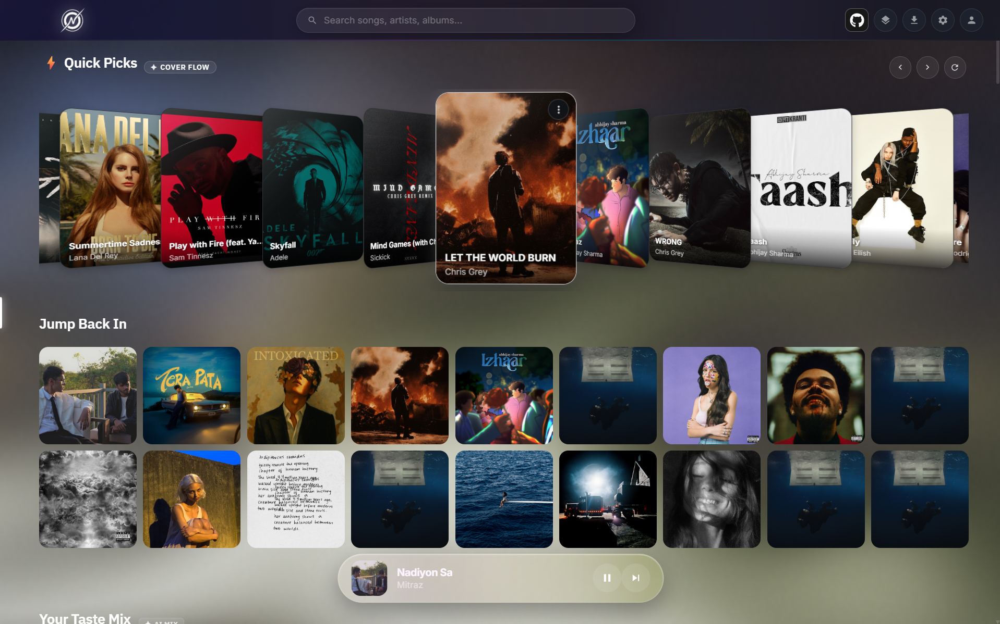
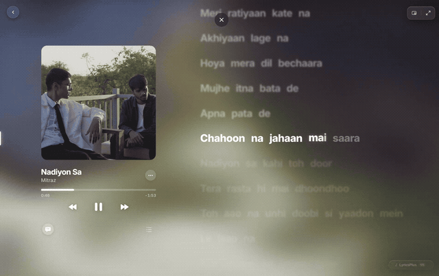
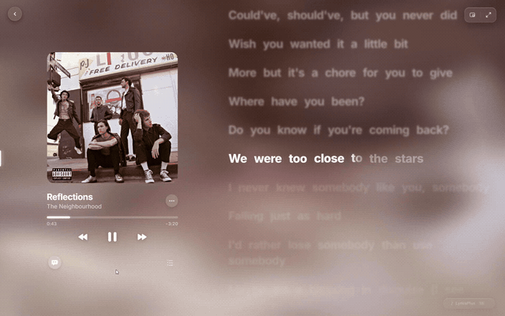

<div align="center">

  

  # A X I O T U N E
  ### The Audiophile Web Streaming Platform Engineered for Aesthetic & Performance

  <p align="center">
    <b>Apple Liquid Glass Architecture &middot; Syllable-Level Karaoke Sync &middot; 3D Vinyl Engine &middot; Web Audio DSP Studio</b>
  </p>

  <p align="center">
    <a href="https://axiotune.onrender.com"></a>
    <a href="https://github.com/Axion-Builds/AxioTune"></a>
    <a href="https://github.com/Axion-Builds/AxioTune/blob/main/LICENSE"></a>
    <a href="https://www.python.org/"></a>
    <a href="https://fastapi.tiangolo.com/"></a>
  </p>

  <p align="center">
    <a href="#about-axiotune">About</a> &bull;
    <a href="#screen-recordings--media">Screen Recordings</a> &bull;
    <a href="#core-features">Features</a> &bull;
    <a href="#audio-dsp-pipeline">Audio DSP</a> &bull;
    <a href="#lyrics-engine">Lyrics Engine</a> &bull;
    <a href="#architecture">Architecture</a> &bull;
    <a href="#quickstart">Quickstart</a> &bull;
    <a href="#keyboard-shortcuts">Shortcuts</a>
  </p>

</div>

---

## About AxioTune

Most modern web music players are either sluggish Electron wrappers bundled with tracker telemetry, or minimal clones limited to basic playback.

**AxioTune** is built on a fundamentally different standard: delivering an audiophile-grade web streaming experience that unifies studio sound processing, real-time syllable-synchronized karaoke lyrics, and an authentic Apple "Liquid Glass" interface into a single, blazing-fast client.

Built with **pure Vanilla JavaScript and Modern CSS** on the frontend and an asynchronous **FastAPI (Python)** backend, AxioTune achieves sub-second cold starts, 60 to 120 FPS hardware-accelerated animations, and zero framework bundle overhead.

Zero audio ad interruptions. Zero subscription barriers. 100% free and open-source.

> **Core Capabilities at a Glance:**
>
> - **Syllable-Level Vocal Karaoke**: Progressive left-to-right text-fill wipes parsed from Apple Music TTML and word-synced LRC files, complete with a floating hover-expandable glass dock for instant provider switching, Romanization, translation, and millisecond sync tuning.
> - **Client-Side Audio DSP Studio**: Real-time Haas 3D stereo widening, 360-degree 8D orbital binaural panning, ReplayGain volume normalization, and variable pitch/tempo controls running natively in the browser via the Web Audio API.
> - **Interactive 3D Vinyl Turntable**: High-precision vinyl physics, realistic grooved light reflections, and animated stylus needle tracking.
> - **Liquid Glass Design System**: Multi-layer frosted glass, dynamic specular highlights, and real-time GPU mesh backgrounds colored by the current album artwork.
> - **Offline PWA Persistence**: Automatic IndexedDB audio caching allows previously played tracks to load and play offline without re-streaming.

---

## Screen Recordings & Media

### Desktop Playback Interface

<p align="center">
  
  <br />
  <sub><em>Full desktop interface showing active track details, queue sidebar, quick picks, and ambient canvas background.</em></sub>
</p>

<br />

### Live Demonstrations

<table>
  <thead>
    <tr>
      <th width="50%" align="center"><b>Interface Navigation & Quick Picks</b></th>
      <th width="50%" align="center"><b>Syllable-Level Lyrics & Hover Dock</b></th>
    </tr>
  </thead>
  <tbody>
    <tr>
      <td align="center">
        <a href="https://raw.githubusercontent.com/Axion-Builds/AxioTune/main/assets/recordings/axiotune-navigation-demo.mp4">
          
        </a>
        <br />
        <sub><em>Browsing carousels, responsive layout, and track playback. (<a href="https://raw.githubusercontent.com/Axion-Builds/AxioTune/main/assets/recordings/axiotune-navigation-demo.mp4">View Full MP4</a>)</em></sub>
      </td>
      <td align="center">
        <a href="https://raw.githubusercontent.com/Axion-Builds/AxioTune/main/assets/recordings/axiotune-lyrics-sync-demo.mp4">
          
        </a>
        <br />
        <sub><em>Real-time syllable karaoke vocal wipe and liquid glass dock. (<a href="https://raw.githubusercontent.com/Axion-Builds/AxioTune/main/assets/recordings/axiotune-lyrics-sync-demo.mp4">View Full MP4</a>)</em></sub>
      </td>
    </tr>
  </tbody>
</table>

---

## Core Features

### 1. Liquid Glass Interface
- **Dynamic Specular Optics**: Layered backdrop blurs (`backdrop-filter: blur(28px) saturate(190%)`), subtle border rim reflections, and multi-stop elevation shadows.
- **Adaptive Canvas Engine**: Extracts dominant and accent colors from the active album cover to paint a smooth, moving GPU gradient backdrop.
- **Fluid Spring Animations**: Micro-interactions and card transitions driven by `cubic-bezier(0.16, 1, 0.3, 1)` easing.
- **Responsive Layout**: Adapts between a desktop split-view (player, lyrics, queue) and a focused mobile-optimized sheet interface.

### 2. Better-Lyrics Engine
- **Syllable-Level Vocal Wipe**: Parses word-level timestamps (TTML and extended LRC) for left-to-right progressive karaoke fills.
- **Hover-Expandable Control Dock**: A compact, floating Apple-style capsule dock that rests non-intrusively and smoothly expands on mouse hover to reveal version switchers, timing controls, and language tools.
- **Multi-Provider Fallback**: Discovers and switches between available lyrics sources (LRCLIB, synchronized providers, plain text fallbacks).
- **Millisecond Timing Offset**: Fine-tune lyric sync on the fly with `+0.1s` / `-0.1s` adjustment buttons to eliminate audio-display lag.
- **Romanization & Translation**: One-click toggles for non-Latin script pronunciation and machine translation.

### 3. Interactive 3D Vinyl Turntable
- **Realistic Turntable Physics**: Rotational inertia, acceleration/deceleration curves, and realistic vinyl surface specular shine.
- **Stylus Tracking**: Animated tonearm that positions itself dynamically based on current track progress.

### 4. Audio DSP Studio (Web Audio API)
- **3D Spatial Stereo**: Expands the perceived soundstage using a Haas delay network and acoustic frequency filtering.
- **8D Orbital Panner**: Binaural cyclical panning that moves sound around the stereo field for headphone listening.
- **Smart Crossfade**: Configurable 0s to 12s transitions between consecutive tracks in the playback queue.
- **ReplayGain Normalizer**: Dynamic gain scaling to balance volume across quiet and loud tracks.
- **Speed & Pitch Adjustment**: Independent playback speed controls (0.25x to 2.0x).

### 5. Offline Caching & PWA
- **IndexedDB Storage**: Saves played songs and metadata locally so tracks can be replayed without re-downloading.
- **Service Worker**: PWA service worker handles asset caching for instant offline app loading.

### 6. WebSocket Party Mode
- **Synchronized Listening Rooms**: Real-time room synchronization keeping playback position within milliseconds across connected devices.
- **Collaborative Queue**: Multiple users can append songs and manage the playlist in real time.

---

## Audio DSP Pipeline

```
[Audio Source] -> [ReplayGain Normalizer] -> [Variable Speed/Pitch Node]
                         |
                         v
              [3D Haas Spatial Matrix]
                         |
                         v
              [8D Orbital Binaural Panner]
                         |
                         v
              [Gain / Crossfade Node] -> [Stereo Master Output]
```

---

## Tech Stack

| Layer | Technologies | Purpose |
| :--- | :--- | :--- |
| **Backend** | Python 3.10+, FastAPI, Uvicorn | Async REST API, WebSocket party rooms, stream resolving |
| **Audio Resolvers** | ytmusicapi, yt-dlp | Search indexing, album metadata, audio stream extraction |
| **Lyrics Provider** | LRCLIB API, synced lyrics parser | Word-level TTML timestamps and line-synced LRC text |
| **Frontend Core** | Vanilla HTML5, CSS3, ES2022 JavaScript | Lightweight client architecture without framework overhead |
| **Graphics & DSP** | WebGL Canvas, Web Audio API | Ambient visualizer canvas, 3D spatializer, 8D orbital panner |
| **Client Storage** | IndexedDB, Cache Storage API | Offline audio blob caching and local preferences storage |

---

## Quickstart

### Prerequisites
- Python 3.10 or higher
- FFmpeg (recommended for audio stream processing)
- Git

### 1. Clone the Repository
```bash
git clone https://github.com/Axion-Builds/AxioTune.git
cd AxioTune
```

### 2. Install Python Dependencies
```bash
pip install -r requirements.txt
```

### 3. Launch the Server

**Windows:**
```powershell
python backend.py
```
*(Or double-click `start_server.bat`)*

**macOS / Linux:**
```bash
python3 backend.py
```

### 4. Access the Application
Open your web browser and navigate to:
```
http://localhost:10000
```

---

## Running with Docker

```bash
# Build the container image
docker build -t axiotune .

# Run container on port 10000
docker run -d -p 10000:10000 --name axiotune-app axiotune
```

Access the application at `http://localhost:10000`.

---

## Keyboard Shortcuts

| Shortcut | Action |
| :--- | :--- |
| <kbd>Space</kbd> | Play / Pause |
| <kbd>L</kbd> | Toggle Synced Lyrics View |
| <kbd>K</kbd> or <kbd>&rarr;</kbd> | Next Song |
| <kbd>J</kbd> or <kbd>&larr;</kbd> | Previous Song / Restart Track |
| <kbd>M</kbd> | Mute / Unmute Volume |
| <kbd>S</kbd> | Toggle 3D Spatial Audio |
| <kbd>8</kbd> | Toggle 8D Orbital Audio |
| <kbd>F</kbd> | Toggle Fullscreen Mode |
| <kbd>/</kbd> | Focus Search Bar |
| <kbd>Esc</kbd> | Close Modal / Exit Fullscreen |

---

## Deployment Notes

AxioTune is ready for containerized or platform deployments (Render, Railway, Fly.io, VPS):

- **Build Command**: `pip install -r requirements.txt`
- **Start Command**: `python backend.py`
- **Environment**: Set `PORT=10000` (or allow the platform to assign `$PORT`).

---

## License

This project is licensed under the [MIT License](LICENSE).
<br />
Developed by **Adarsh Shukla** ([Axion Builds](https://github.com/Axion-Builds)).
